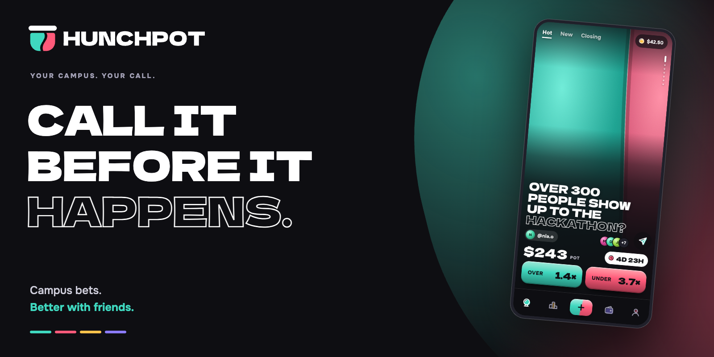
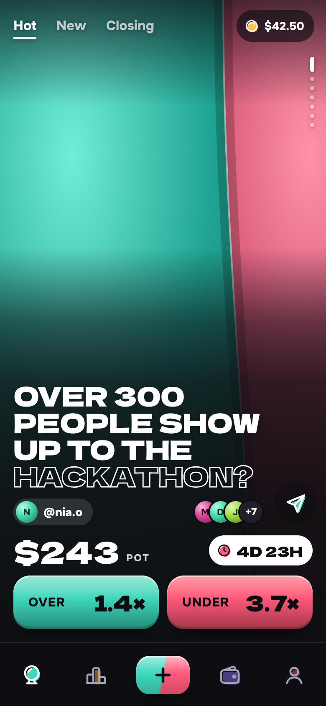
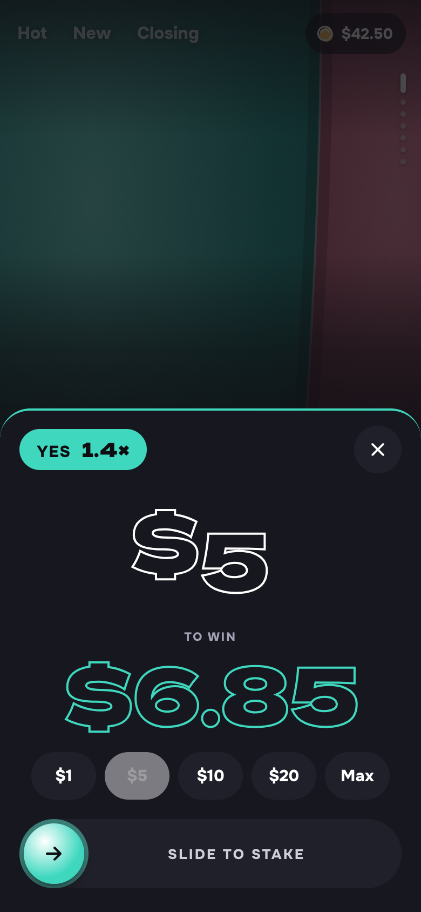
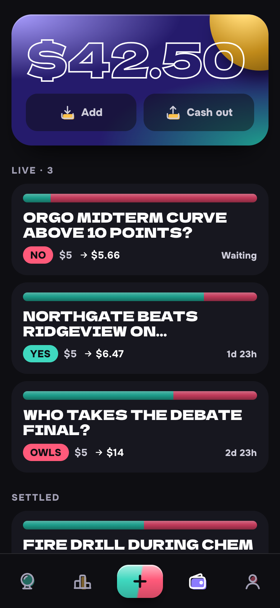
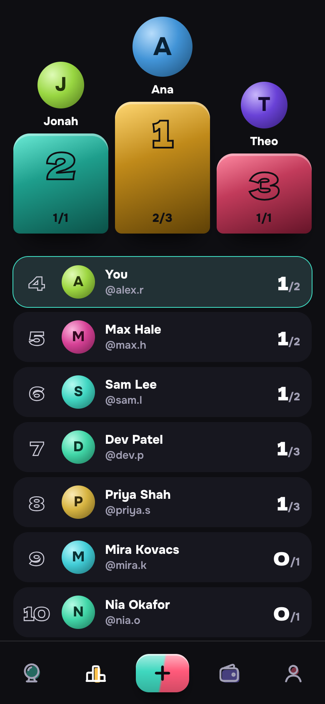
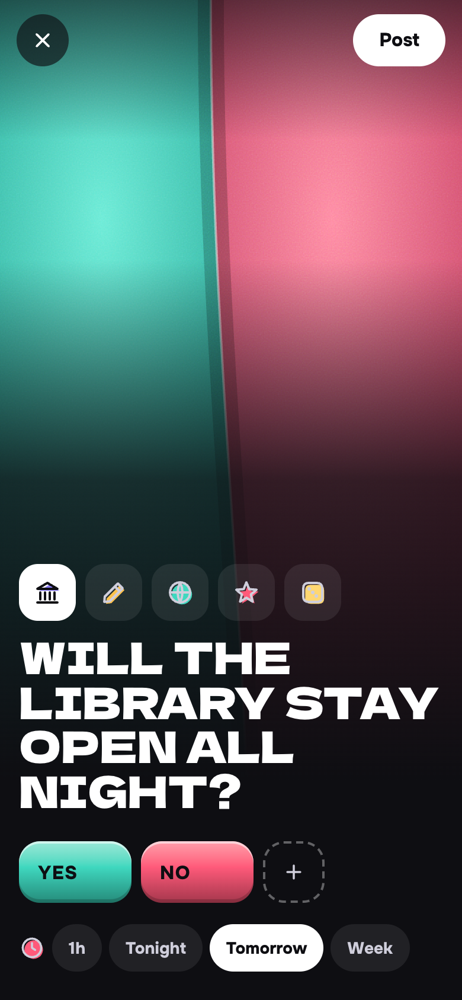
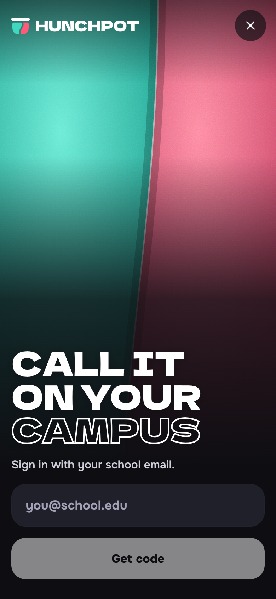

<div align="center">



**Your campus. Your call. One shared pot.**

Turn the “I bet you…” moments of campus life into a call your friends can join.

[Screenshots](#a-look-inside) · [Quick start](#run-it-locally) · [How it works](#the-pot-is-the-story) · [Project status](#where-it-stands)


</div>

---

Hunchpot is a mobile-first, peer-to-peer pool betting prototype for school and university communities. Students create a hunch, friends pick a side, and the pool determines the odds. The focus is the stuff happening around you: the midterm, the campus game, the debate final, the next snow day.

The demo uses fictional students, campuses and balances. Payments and live settlement are not implemented yet.

## A look inside

<table>
  <tr>
    <td align="center" width="33%"><br /><strong>01 / Make the call</strong><br /><sub>One hunch. The whole screen.</sub></td>
    <td align="center" width="33%"><br /><strong>02 / Pick your side</strong><br /><sub>See the payout. Slide to commit.</sub></td>
    <td align="center" width="33%"><br /><strong>03 / Follow your bets</strong><br /><sub>Your balance, positions and results.</sub></td>
  </tr>
</table>

<details>
<summary><strong>More screens — Rank, create a hunch, campus sign-in</strong></summary>
<br />

<table>
  <tr>
    <td align="center" width="33%"><br /><strong>Campus bragging rights</strong></td>
    <td align="center" width="33%"><br /><strong>Start a hunch</strong></td>
    <td align="center" width="33%"><br /><strong>Your campus, by email</strong></td>
  </tr>
</table>

</details>

<sub>Actual app screenshots from the local seeded demo. All people, schools and amounts shown are fictional.</sub>

## The pot is the story

- **A feed built for a thumb.** One bet per viewport, with Hot, New and Closing views. Browse without signing in.
- **Odds you can see.** Mint, coral, butter and iris fields show the pool split. Their seams move when a stake changes it.
- **Slide to stake.** Choose an outcome, enter an amount and preview the estimated payout. Drag to confirm; keyboard confirmation is supported too.
- **A crowd behind every call.** Open the crowd sheet to see the host and who backed each side.
- **Your campus first.** School email codes verify membership. Students can stake and create within their own open campus; waitlisted campuses unlock at a member threshold.
- **Keep your calls close.** Pocket tracks positions and seeded results; Rank shows the campus leaderboard. Share links open directly on a bet.

### Pool-based odds

Hunchpot uses a **parimutuel** pool: participants back outcomes, and the winning side shares the pot in proportion to its stakes. There is no house-funded side of the bet.

For a pool with **$60 on Yes** and **$40 on No**, the current Yes multiplier is **$100 / $60 ≈ 1.67×**. Someone holding $6 of that Yes pool would receive about $10 if Yes wins, including their stake. Adding money changes both the pool and the estimate; final returns depend on the final pool. The prototype models this without a platform fee, and live settlement is still to be built.

## Run it locally

You need Git and Docker with Compose. The first build downloads dependencies and the app's Google Fonts.

```sh
git clone https://github.com/MaksymShupeikin/hunchpot.git
cd hunchpot
docker compose up --build
```

| Service | Open |
| --- | --- |
| Web app | [localhost:3000](http://localhost:3000) — use a phone-sized viewport |
| API docs | [localhost:8000/docs](http://localhost:8000/docs) |
| Demo inbox | [localhost:8025](http://localhost:8025) — Mailpit captures all local email |
| PostgreSQL | `localhost:5432` · database / user / password: `hunchpot` |

On first start, the API creates the tables and seeds Northgate U with **12 fictional students and 12 bets**, plus a waitlisted campus.

### Try the full flow

1. Browse the feed, open a bet or check Rank as a guest.
2. Sign in as **`alex.r@northgate.edu`** to explore the seeded student's Pocket and existing positions.
3. Open [Mailpit](http://localhost:8025), copy the six-digit code and enter it in the app.
4. Pick a side, try a demo stake or create a hunch.

Any other `@northgate.edu` address creates a student on the open campus. An `@ridgeview.edu` address demonstrates the campus waitlist. Unknown domains go to the school request list. Local sign-in messages stay in Mailpit.

<details>
<summary><strong>Develop with hot reload</strong></summary>

Keep the database, mail and API in Docker; run Next.js locally with Node.js 22:

```sh
docker compose up -d db mail api
cd web
npm ci
npm run dev
```

The web app uses `http://localhost:8000` by default. Set `API_URL` if your API lives elsewhere.

```sh
npm run lint
npm test
npm run build
```

To stop the containers, run `docker compose down` from the repository root. To reset the demo, `docker compose down -v` also **deletes the local database volume**; the next start seeds a fresh database. Existing pre-campus-auth demo databases can instead apply [`api/sql/2026-10-23-campus-auth.sql`](api/sql/2026-10-23-campus-auth.sql) once.

</details>

## Under the lid

| Layer | Built with |
| --- | --- |
| Interface | Next.js 16 App Router, React 19, TypeScript, CSS Modules |
| Backend | FastAPI, Pydantic, async SQLAlchemy, asyncpg |
| Data | PostgreSQL 17; money stored as integer cents |
| Identity | School email + one-time code; server-side sessions |
| Local runtime | Docker Compose + Mailpit |
| Visual identity | Dela Gothic One, Onest, custom generated two-plate icons |

```text
api/
  src/models/       Schools, users, bets, outcomes, stakes and sessions
  src/routers/      Auth, bets, stakes, profiles and leaderboard
  src/services/     Demo seed, campus access, records and SMTP mail
web/
  src/app/          Feed, bet pages, Pocket, Rank, Me and composer
  src/components/   Pot fields, stake and crowd sheets, navigation
  scripts/icons.mjs Custom icon generator → Icon.tsx
  public/brand/     Original logo and wordmark in SVG + PNG
docs/assets/        README cover, logo variants and app screenshots
```

The design keeps everything in a single phone column, even on desktop: dark ground, lit colour fields, oversized display type and exactly one outlined word per question. Read the [product context](PRODUCT.md) and [design system](DESIGN.md) for the full direction.

## Where it stands

**An interactive product prototype with working campus authentication, bet creation and demo staking.** The interface is ahead of the production business logic.

| Available in the prototype | Still to build |
| --- | --- |
| Guest feed, shareable bet pages and crowd sheets | Deposits and cash-outs; current balances are demo data |
| School email codes and campus waitlists | Live outcome resolution, settlement and disputes |
| Creating bets and staking from a demo balance | Platform fees and production database migrations |
| Pocket, seeded history and leaderboard | Notifications, moderation and broader school onboarding |

Implementation shortcuts are marked inline:

```sh
rg 'shortcut:' api web/src
```

<details>
<summary><strong>Deployment notes</strong></summary>

The checked-in Compose file is for local development. Before a production deployment:

- Set a long, random `SECRET` on the API and `COOKIE_SECURE=true` on the web app behind HTTPS.
- Set `SMTP_HOST`, `SMTP_PORT`, `SMTP_USER`, `SMTP_PASSWORD`, `SMTP_STARTTLS` and `SMTP_FROM` for your mail server. Mailpit is the local inbox only.
- The intended mail setup is an owned Postfix server with SPF, DKIM, DMARC, a matching PTR record and outbound port 25 available.
- Replace automatic `create_all` schema creation with migrations and replace the seeded school list with real onboarding data.
- Complete payments, settlement, moderation and the required age, identity and regional compliance work before accepting real stakes.

</details>

---

<div align="center">
  <picture>
    <source media="(prefers-color-scheme: dark)" srcset="docs/assets/logo-dark.svg" />
    
  </picture>
  <br />
  <sub>Call it before it happens.</sub>
</div>
